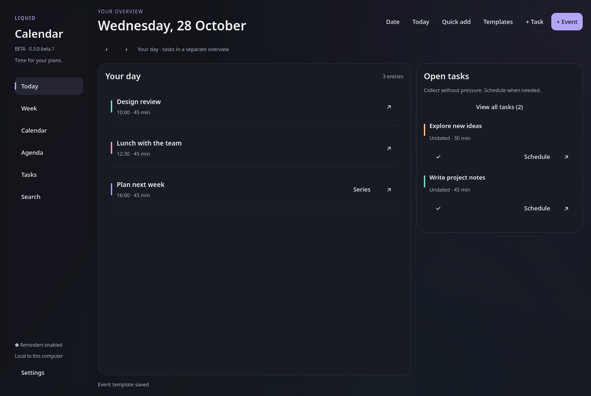
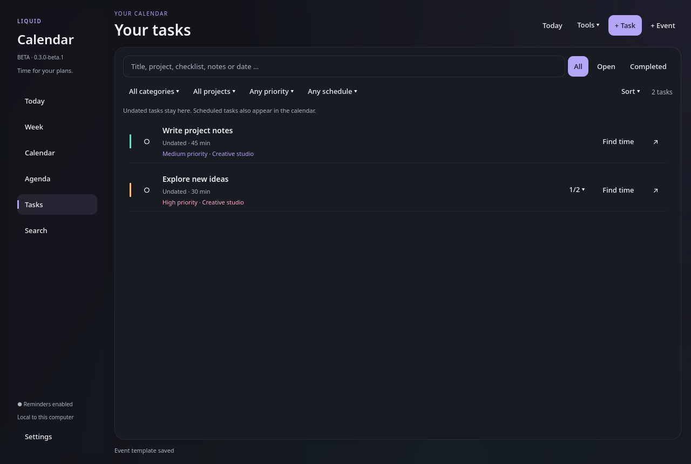
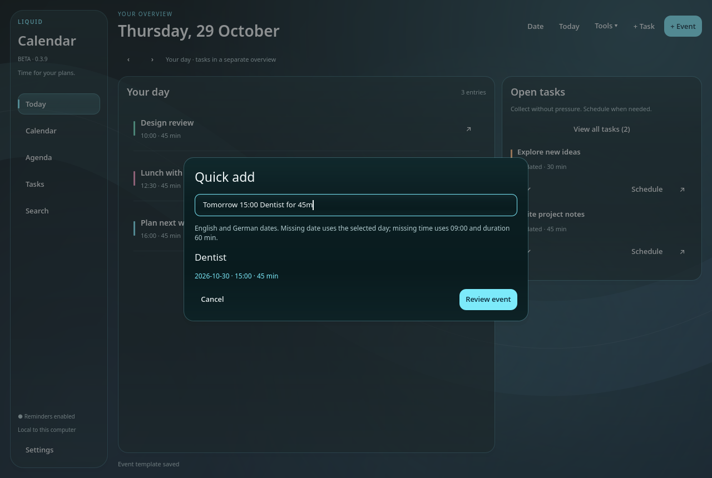

# Liquid Calendar · Beta

A local desktop calendar and task planner for **Fedora Linux / KDE Plasma 6**. English interface, no account required.

**Repository version: 0.3.9.2 Beta** · Updated **2026-10-30** · **GPL-3.0-or-later**

[Latest packaged release: 0.3.9.1](https://github.com/jonas101201/liquid-calendar/releases/tag/v0.3.9.1) · [Release notes](RELEASE_NOTES.md) · [Known issues](KNOWN_ISSUES.md) · [Roadmap](ROADMAP.md)



**0.3.9.2** reworks previously incorrect event merging and nested-event display. Related events remain separate, contained events appear inside their longer background card, and mutual group overlaps no longer trigger conflict warnings. Cleaner cards protect the outer title and retain individually editable details. See [what changed](RELEASE_NOTES.md).

## Features

- Today overview, 24-hour weekly timeline, month and 7/14/30-day agenda views.
- Undated tasks with optional scheduling, categories, filters and sorting. Complete individual occurrences of repeating tasks while keeping future repetitions open.
- Task priorities, editable checklists and projects, with combined filters and sorting.
- Search across years using titles, projects, checklist steps, locations, notes, dates and partial month/day names.
- Quick event drafts, calendar/time pickers and a reusable event-template library.
- Repeats with selectable weekly weekdays, individual occurrences, reminders and available-time suggestions.
- Conflict-aware local storage, undo, daily backups and optional Plasma widget.
- JSON backup/import and ICS event export.



Saved events and individual repeat occurrences can be linked through **More ▾ → Link with another event…**, with a two-card preview and Undo. For School 07:00–14:00 and Exam 09:00–10:00, the exam appears as an independent card inside School. Both remain editable, movable and removable; **Unlink group** keeps both. Unrelated overlapping bookings still receive separate lanes and conflict indicators. See [event linking](docs/EVENT_LINKS.md).

The latest packaged download is still 0.3.9.1; it does not contain the 0.3.9.2 source changes.

**0.3.7-beta.1** fixes exact-date search, concurrent task scheduling and supported date-boundary failures. See [the bug audit](docs/BUG_AUDIT_0.3.7.md) and [release record](docs/RELEASE_0.3.7.md).

**0.3.6-beta.1** includes the complete 0.3.0 milestone and all six development patches. Earlier 0.3.0–0.3.5 snapshots were not published separately. See [the release record](docs/RELEASE_0.3.6.md).

## Roadmap

See the [roadmap](ROADMAP.md) for the ten beta milestones, planned features and bug-fix versioning rules.

## Install

Requirements: Fedora/KDE Plasma 6, **Python 3.10–3.14**, venv/pip support, network access to PyPI and the system Qt platform libraries. `notify-send` is needed for notifications. Other systems are not validated.

Download an archive from the [0.3.9.1 release](https://github.com/jonas101201/liquid-calendar/releases/tag/v0.3.9.1), extract it and open a terminal in its folder:

```bash
python3 installieren.py
```

To also install the optional Plasma widget:

```bash
python3 installieren.py --with-widget
```

No sudo is needed. The installer creates a per-user virtual environment with pinned Qt dependencies and an application-menu entry **Liquid Calendar Beta**. It backs up existing program files and never opens or modifies the event database. The download contains source code, not bundled third-party runtime binaries.

After an update, quit the old app using **Ctrl+Q** and reopen it. Add **Liquid Glass Calendar (Beta)** through Plasma's widget picker if installed. An active widget must support sharing protocol 3 for selected-weekday repeats. If an old widget is active, use **Connect** when prompted; this briefly reloads the desktop and panels.

**Beta scope:** Fedora/KDE Plasma is the target. See [known limitations](KNOWN_ISSUES.md) and [testing details](TESTING.md) for supported behavior and validation scope.

## Use

Create **+ Event** or **+ Task**. Tasks are undated by default. **Schedule in calendar** or **Find time** assigns a date explicitly; suggestions cover 09:00–18:00. More options reveals categories, repeats, reminders, locations and notes. Dragging a repeating event moves only that occurrence; use **Series** to edit the whole series.

In **+ Task**, choose No priority, Low, Medium or High, enter an optional project and add checklist steps. Tasks remain undated unless explicitly scheduled. The Tasks view combines project, priority, category, status, schedule and text filters; **Reset** clears them. Use **Sort** for priority or project ordering. The checklist counter expands inline steps. Completing all steps does not automatically complete the task.

Projects are created by assigning a name to a task. Project menus show completed/total task records, including detached occurrences. Select a project and use **Edit project** to rename it, merge it with an existing name, or clear its assignments without deleting tasks. App-wide Undo covers these edits. Project names are case-sensitive and limited to 80 characters; `*` is reserved. Each task supports up to 100 checklist steps.

For repeating tasks, inline checklist clicks affect only that occurrence; future repetitions keep their original checklist. **Series** edits the checklist template for the whole series.

**Tools ▾ → Quick add** (Ctrl+Shift+N) turns `tomorrow 15:00 Dentist for 45m` or `Morgen 15 Uhr Zahnarzt für 45 Minuten` into a preview. **Review event** opens the editor; only **Save** inserts the event. Recognized input includes English/German full weekday names, today/tomorrow/day after tomorrow, ISO dates, `15.03.2027`, `15.03.`, 24-hour `HH:MM`, `15 Uhr`, `3 pm`, `3:45 pm`, `all day`/`ganztägig`, and `for 45m`/`for 2h` durations. Weekdays include today when matching. Relative dates use the actual current day, regardless of the selected month. Missing dates use the selected day, missing times use 09:00, and missing duration is 60 minutes. Ambiguous multiple dates/times and invalid dates are rejected. This is a limited parser; always review the draft.

Use **Pick…** beside Date or Time for the month/year grid or hour/minute controls. Repeat end dates also have a picker. Manual ISO date/time input remains available. The companion widget gets these pickers too.

**More ▾ → Save template…** in the event editor stores title, time, duration, category, reminder, location and notes. **Tools ▾ → Event templates → Use** creates a fresh draft on the selected day. Dates, repeats, completion states, task details and series identities are never copied. Templates currently support events only. The library supports up to 50 templates with names of 1–80 characters; manage a template to rename or delete it. Existing events are unaffected by template deletion. Template changes are separate from event Undo.



For **Repeat → Weekly**, select one or more days under **Repeats on** (e.g. Mon/Wed/Fri). The start date is the earliest allowed date; only selected weekdays occur. At least one day stays selected. Existing weekly series without an explicit day selection retain their original weekday until edited. JSON backups and ICS `BYDAY` exports preserve the selection. Editing, moving or completing one occurrence does not change the other days.

Search `today`, `tomorrow`, `day after tomorrow`, `wed`, `nov`, `2027-03-15` or `15.03.2027`. Dates use English names and 24-hour time. German query aliases remain supported, but there is no language selector. Slash-based US dates are not supported.

When completing a repeating task, only the selected occurrence is completed. You can reopen that occurrence without creating a duplicate. If an older beta marked a whole series completed, explicitly reopen that legacy series to make future occurrences available again. Updating does not automatically rewrite stored completion states.

Reminders require the app to be open or running in the tray. Closing the window may keep it running. **Ctrl+Q** fully quits. Optional login startup is disabled by default.

- **Ctrl+Shift+N:** quick event entry
- **Ctrl+N:** new event
- **Ctrl+F:** search
- **Ctrl+Z:** undo last change
- **Ctrl+Q:** quit app and reminders

## Data and privacy

No cloud synchronization, account sign-in or analytics are implemented. Data stays local. The app shares the companion widget's SQLite database at:

```text
~/.local/share/plasmashell/QML/OfflineStorage/Databases/dd9450f249be1bf7e7f3854d39b8b74b.sqlite
```

Program files are installed under `~/.local/share/liquid-glass-planner/`. Daily data backups are kept in its `backups/` directory (latest 14 daily files). Program-update backups are stored separately within that directory. Back up important data before beta use. JSON preserves events, tasks and their metadata; it does **not** include the separate template library. Automatic SQLite backups include templates. ICS exports calendar events only. Import adds new IDs without replacing existing IDs.

## Develop

```bash
python3 -m venv .venv
.venv/bin/python -m pip install -r requirements.txt
./launch.sh --smoke-test
.venv/bin/python -m unittest discover -s tests -p 'test_*.py' -v
```

Use `--smoke-test` or `--database /path/to/a/test.sqlite` for development. Do not run against a personal database. See [TESTING.md](TESTING.md), [CONTRIBUTING.md](CONTRIBUTING.md) and [THIRD_PARTY.md](THIRD_PARTY.md).

## License

Copyright © 2026 Jonas. Project source and assets are licensed under **GNU GPL version 3 or later**, without warranty. See [LICENSE](LICENSE) and [NOTICE](NOTICE). External dependencies retain their own licenses; see [THIRD_PARTY.md](THIRD_PARTY.md).
